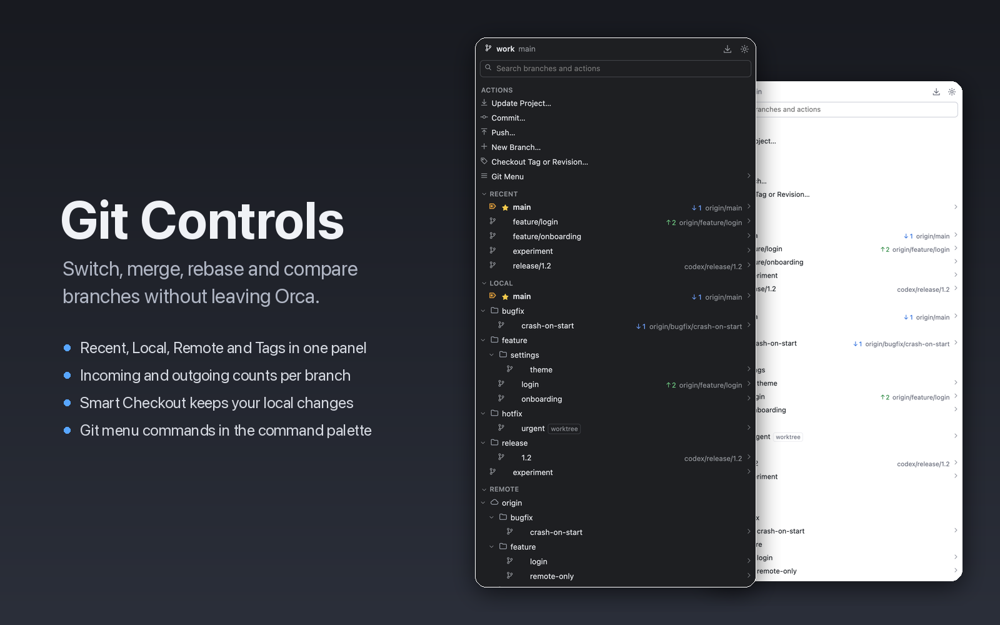
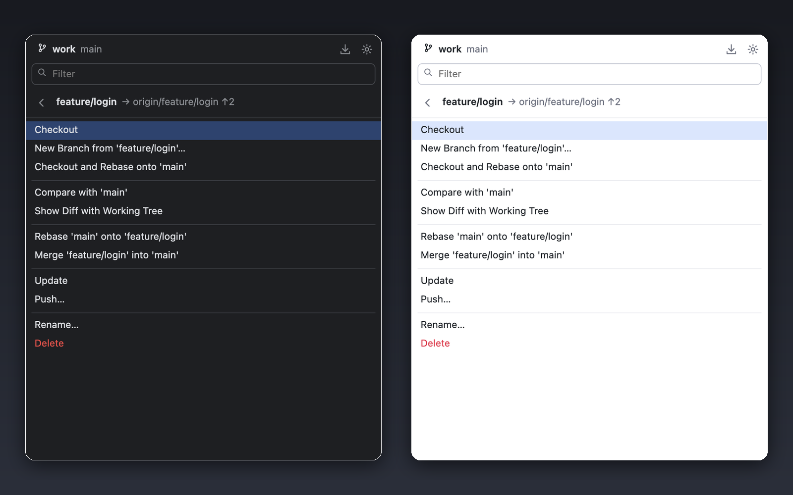

# Git Controls for Orca

Switch, create, merge, rebase and compare branches without leaving Orca. Git Controls adds a
branches panel and a Git menu that work on the checkout of the focused workspace.

## Install

- **From the catalog:** click **Open in Orca** on the
  [plugin page](https://www.onorca.dev/plugins/jodac/orca-git-controls), or search for
  "Git Controls" in **Settings → Plugins**.
- **From Git:** in **Settings → Plugins**, install from
  `https://github.com/JoDaC/orca-git-controls.git#v0.1.0`.

Requires Orca 1.4.246 or later and Git 2.23 or later.

## Usage

Open **Git Controls** from the branch icon in the right sidebar. Type to filter branches and
actions; the arrow keys and Enter move through the list. Click a branch's chevron for its
actions. Every Git menu item is also in the command palette under `Git:`.

## Features

- **Branches:** Recent, Local and Remote grouped into `/` folders, and Tags. Each branch shows
  its upstream, incoming and outgoing commit counts, and a favorite star.
- **Branch actions:** checkout, new branch from, checkout and rebase, compare, diff with the
  working tree, rebase onto, merge into current, update, push, rename, delete.
- **Git menu:** commit, push, pull, fetch, update project, merge, rebase, new tag, reset HEAD,
  worktrees, Git log, patches, stash and unstash, rollback, file history and blame.
- **Smart Checkout:** when your local changes block a checkout, stash them, switch and restore
  them, or force the checkout.
- **Worktrees:** a branch checked out in another worktree opens that worktree in Orca.
- **Safe by default:** destructive actions always ask first, force push uses
  `--force-with-lease`, and git's errors are shown as git printed them.
- Refreshes when a terminal or an agent changes the repository, and follows Orca's light and
  dark themes.

## Privacy & access

Orca lists Git Controls as **Full access** because it runs git on your machine. It makes no
network calls of its own; only git's own fetch, pull and push reach your remotes. It asks for:

- `workspace:read` to find the focused workspace;
- `notifications:show` to report the results of palette commands;
- `storage:own` and `settings:own` to keep your favorites and settings.

## Limitations

- Local workspaces only; SSH and remote Orca hosts are not supported.
- Desktop app only; it does not run in Orca's browser client.
- Tested on macOS. Linux and Windows should work but are untested.
- The panel lives in the right sidebar. Plugins cannot add popups, menu bar entries or a
  shortcut that opens a panel.
- "Current File" commands ask which file, because plugins cannot see the active editor tab.
- No interactive rebase or cherry-pick.

## Contributing

Bugs and ideas: [open an issue](https://github.com/JoDaC/orca-git-controls/issues). To run the
plugin from source, see [CONTRIBUTING.md](CONTRIBUTING.md).

## License

MIT
